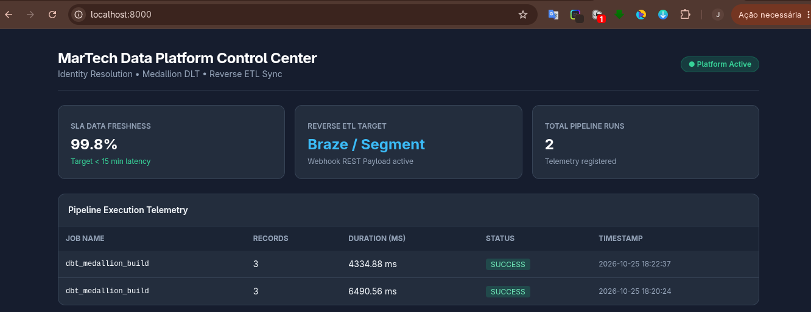

# MarTech Data Ops Platform

A reproducible end-to-end event data pipeline designed for MarTech customer data activation. It ingests raw tracking signals, resolves user identity across unauthenticated sessions, models Customer 360 RFM attributes using dbt, and syncs enriched audiences downstream to CDP targets (Braze/Segment format).

Includes real-time pipeline telemetry, runtime metrics logging, and a lightweight control dashboard.

---

## Architecture Overview